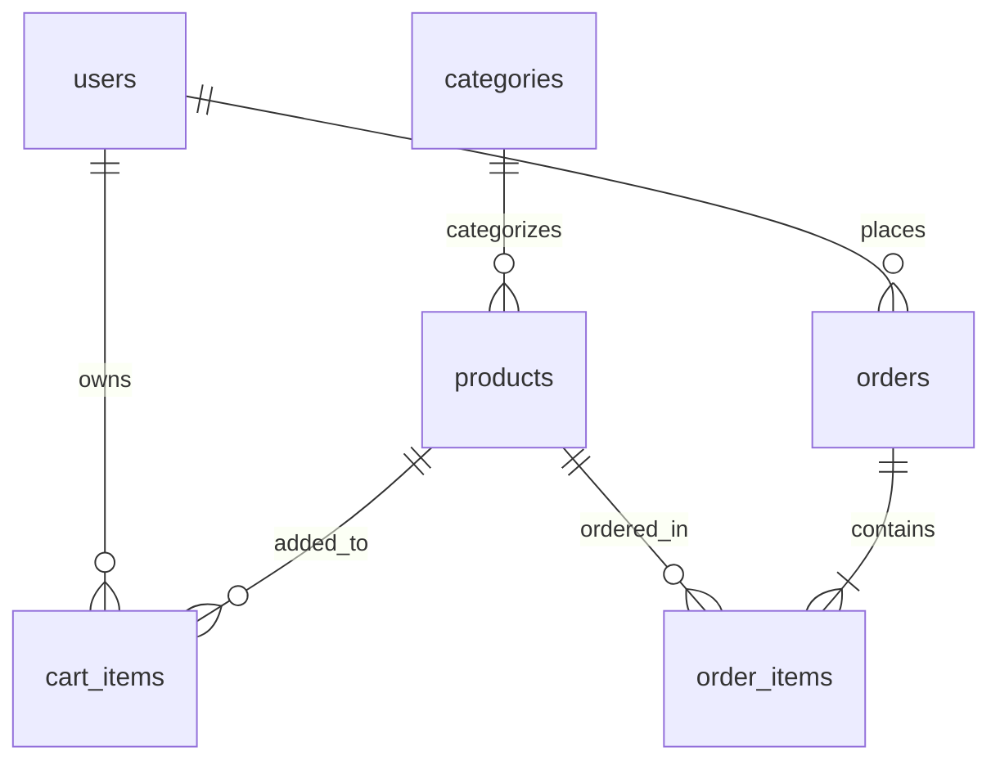

# ShopEasy — E-Commerce Application

A full-stack, responsive, and secure e-commerce platform built with **Node.js, Express.js, SQLite (better-sqlite3), and Vanilla JavaScript**. Designed to demonstrate end-to-end client-server architecture, database transactions, role-based access control, and Cash on Delivery order processing.

---

## 1. Project Overview & Objectives

**ShopEasy** is a complete, beginner-to-advanced internship-grade web application where:
- **Guests** can seamlessly browse, search by keyword, filter by categories, sort by price/name, view product details, and check stock availability.
- **Customers** can register, log in, maintain a persistent shopping cart with live inventory verification, place Cash on Delivery (COD) orders protected by database transactions, track past orders, and cancel placed orders.
- **Administrators** have access to a secure, role-protected portal displaying real-time aggregated store analytics, complete product catalog CRUD with low-stock alerts, and full order lifecycle management (`Placed` &rarr; `Shipped` &rarr; `Delivered`).

### Key Highlights
- **Atomic Database Transactions:** Multi-step checkout (order creation, order items persistence, stock deduction, and cart clearing) executes inside an atomic SQLite transaction, ensuring zero overselling and rollback on failure.
- **Financial Precision:** Product prices and order totals are stored strictly as integer **paise** (1 Rupee = 100 paise), avoiding IEEE 754 floating-point currency calculation errors.
- **Security First:** Passwords hashed with `bcryptjs` (10 rounds), stateless JWT authentication, server-side validation on all user inputs, parameterized SQL statements, and strict role authorization.
- **Modern Responsive Design:** Crafted with modern CSS Grid and Flexbox, custom design tokens, responsive typography, micro-interactions, and support down to 360px mobile screens.

---

## 2. Technology Stack

- **Backend:** Node.js (v18+), Express.js (REST APIs returning structured JSON).
- **Database:** SQLite with `better-sqlite3` (WAL mode enabled, strict foreign key enforcement via `PRAGMA foreign_keys = ON;`).
- **Security:** `bcryptjs` (password hashing), `jsonwebtoken` (JWT authentication), `dotenv` (environment variables).
- **Frontend:** HTML5, Modern CSS3 (Vanilla CSS with design system, glassmorphism, responsive grid), Vanilla JavaScript (ES6+), Fetch API.
- **Testing:** Jest, Supertest for automated integration and regression testing.

---

## 3. Project Folder Structure

```
shopeasy/
├── .github/
│   └── workflows/
│       └── ci.yml           # GitHub Actions CI matrix workflow (Node 18, 20, 22)
├── server/
│   ├── app.js               # Express application initialization, security headers, & error handling
│   ├── db.js                # SQLite connection, foreign keys, and helpers
│   ├── schema.sql           # DDL: Tables, constraints, and indexes
│   ├── seed.sql             # SQL seed records (categories, products, accounts)
│   ├── seed.js              # Command-line seed runner script
│   ├── middleware/
│   │   ├── auth.js          # JWT verification & req.user attachment
│   │   ├── adminOnly.js     # Role-based 403 admin authorization guard
│   │   ├── customerOnly.js  # Role-based 403 customer authorization guard
│   │   ├── rateLimiter.js   # Sliding-window rate limiter for sensitive endpoints
│   │   └── validate.js      # Strict integer, URL, email, and phone validators
│   └── routes/
│       ├── auth.js          # /api/auth (register, login with rate limiting, me)
│       ├── products.js      # /api/products (public catalog + admin CRUD)
│       ├── categories.js    # /api/categories (list + admin CRUD)
│       ├── cart.js          # /api/cart (customer cart operations)
│       ├── orders.js        # /api/orders (transactional COD checkout & cancellation)
│       └── admin.js         # /api/admin (stats, order status lifecycle management)
├── public/
│   ├── css/
│   │   └── styles.css       # Unified design system, tokens, modal dialogs, & responsive layout
│   ├── js/
│   │   ├── api.js           # Fetch client, currency formatting, toast & custom confirm modal
│   │   ├── auth.js          # Client auth state, dynamic navbar, route guards
│   │   ├── products.js      # Catalog search, filter, pagination, details view
│   │   ├── cart.js          # Shopping cart UI, quantity adjustments
│   │   ├── checkout.js      # COD form validation & checkout submission
│   │   ├── orders.js        # Order history listing, order timeline, & details modal
│   │   └── admin.js         # Admin dashboard stats, products CRUD, orders management
│   ├── index.html           # Public storefront / product catalog
│   ├── product.html         # Product detail view with quantity controls
│   ├── login.html           # Login page with demo credentials quick-fill
│   ├── register.html        # Customer registration page
│   ├── cart.html            # Customer shopping cart
│   ├── checkout.html        # Cash on Delivery checkout page
│   ├── success.html         # Order confirmation page
│   ├── orders.html          # Customer order history
│   └── admin/
│       ├── dashboard.html   # Admin metrics dashboard
│       ├── products.html    # Admin product inventory table & filters
│       └── orders.html      # Admin order status management
├── tests/
│   ├── auth.test.js         # Authentication, rate limiting & RBAC regression suite
│   ├── products.test.js     # Catalog, pagination & admin CRUD regression suite
│   ├── cart.test.js         # Cart operations, quantity limits & ownership regression suite
│   └── orders.test.js       # Transactional checkout, cancellation & status lifecycle suite
├── docs/
│   ├── er-diagram.md        # Mermaid ER diagram and relational documentation
│   └── api-docs.md          # REST API endpoints reference
├── .env.example             # Environment configuration template
├── .gitignore               # Ignored dependencies, DB files, and secrets
├── package.json             # NPM package specification & test scripts
└── README.md                # Project documentation
```

---

## 4. Prerequisites

- **Node.js:** v18.0.0 or later (Tested on Node v18, v20, and v24).
- **npm:** v9.0.0 or later.
- Modern web browser (Chrome, Edge, Firefox, Safari).

---

## 5. Installation & Setup Instructions

### Step 1: Clone or Navigate to the Project Directory
```bash
git clone <repository-url>
cd shopeasy
```

### Step 2: Install Dependencies
```bash
npm install
```

### Step 3: Configure Environment Variables
Copy `.env.example` to create your local `.env`:
```bash
# On Windows PowerShell:
Copy-Item .env.example .env

# On Linux / macOS / Bash:
cp .env.example .env
```

Your `.env` file should configure the following parameters:
```env
# Server Port
PORT=3000

# JWT Authentication Secret (Must be set; server refuses startup if missing)
JWT_SECRET=replace_with_a_long_random_secret

# JWT Token Expiration
JWT_EXPIRES_IN=1d

# SQLite Database File Path
DATABASE_PATH=./server/shopeasy.db

# Environment mode (development / production / test)
NODE_ENV=development
```

> **Generating a Secure Cryptographic JWT Secret:**
> To generate a secure 256-bit random hex secret, run:
> ```bash
> node -e "console.log(require('crypto').randomBytes(32).toString('hex'))"
> ```
> Paste the generated string as the value of `JWT_SECRET` in your `.env` file.
>
> > [!WARNING]
> > The application employs fail-safe configuration checking at startup. If `JWT_SECRET` is missing or undefined, the server will log an explicit error and terminate safely rather than accepting insecure requests.

### Step 4: Initialize and Seed the SQLite Database
Run the automated seed runner:
```bash
npm run seed
```
This script creates tables with constraints and indexes (if not already existing) and seeds initial categories, products, and default accounts.

---

## 6. How to Run the Application

### Start Development Server:
```bash
npm start
```
Or with auto-restart on file changes:
```bash
npm run dev
```

### Application URL:
Open your browser and navigate to:
```
http://localhost:3000
```

---

## 7. Demo Accounts (Development & Review Only)

> [!WARNING]
> **DEVELOPMENT & EVALUATION USE ONLY:** The accounts below are seeded exclusively for local evaluation, portfolio demonstration, and integration tests. In production environments, credentials must be generated uniquely, rotated regularly, and protected via strict secret managers.

| Role | Email | Password | Access Privileges |
| :--- | :--- | :--- | :--- |
| **Administrator** | `admin@shopeasy.com` | `Admin@123` | Admin Portal, Real-time DB Metrics, Catalog CRUD, Order Fulfilment |
| **Customer** | `customer@shopeasy.com` | `Customer@123` | Browsing, Cart Management, COD Checkout, Order Tracking & Cancellation |

*(Note: On `login.html`, click the quick-fill chips under the login form to automatically populate either account for rapid demonstration.)*

---

## 8. Database Architecture & Schema

All monetary figures are stored as integer **paise** (`₹499.00` = `49900` paise). Foreign keys are strictly enforced on every SQLite connection (`PRAGMA foreign_keys = ON;`).



### Schema Summary:
1. **`users`**: `id`, `name`, `email` (UNIQUE), `password_hash`, `role` (customer | admin), `phone`, `address`, `created_at`.
2. **`categories`**: `id`, `name` (UNIQUE).
3. **`products`**: `id`, `category_id` (FK), `name`, `description`, `price` (in paise), `stock`, `image_url`, `is_active`, `created_at`.
4. **`cart_items`**: `id`, `user_id` (FK), `product_id` (FK), `quantity`, `UNIQUE(user_id, product_id)`.
5. **`orders`**: `id`, `user_id` (FK), `total_amount` (in paise), `status` (Placed | Shipped | Delivered | Cancelled), `shipping_name`, `shipping_phone`, `shipping_address`, `shipping_city`, `shipping_pincode`, `payment_method`, `created_at`.
6. **`order_items`**: `id`, `order_id` (FK), `product_id` (FK), `quantity`, `unit_price` (in paise, captured at purchase time).

Detailed entity documentation: see [docs/er-diagram.md](file:///c:/Users/lenovo/OneDrive/Desktop/Intern%20project1/docs/er-diagram.md).

---

## 9. API Reference Overview

Detailed REST API specifications are documented in [docs/api-docs.md](file:///c:/Users/lenovo/OneDrive/Desktop/Intern%20project1/docs/api-docs.md).

| Method | Endpoint | Access | Description |
| :--- | :--- | :--- | :--- |
| **POST** | `/api/auth/register` | Public | Register customer (validates config, email uniqueness, strict types) |
| **POST** | `/api/auth/login` | Public (Rate-Limited) | Authenticate user (10 requests / 15 mins window) |
| **GET** | `/api/auth/me` | Authenticated | Retrieve authenticated user profile |
| **GET** | `/api/products` | Public / Admin | Filter by category, search, sort, and paginate (hides inactive from public) |
| **GET** | `/api/products/:id` | Public / Admin | View product details (rejects inactive unless admin) |
| **POST** | `/api/products` | Admin | Create product with strict integer price, stock, & URL validation |
| **PUT** | `/api/products/:id` | Admin | Update existing product |
| **DELETE**| `/api/products/:id` | Admin | Delete or safely deactivate product |
| **GET** | `/api/categories` | Public | List categories with product counts |
| **POST** | `/api/categories` | Admin | Create category with unique name validation |
| **PUT** | `/api/categories/:id`| Admin | Update category name |
| **DELETE**| `/api/categories/:id`| Admin | Delete category (rejected if products assigned) |
| **GET** | `/api/cart` | Customer Only | Fetch cart items with recalculated totals |
| **POST** | `/api/cart` | Customer Only | Add product to cart with strict stock & quantity limits |
| **PUT** | `/api/cart/:itemId` | Customer Only | Update cart item quantity |
| **DELETE**| `/api/cart/:itemId` | Customer Only | Remove cart item |
| **POST** | `/api/orders` | Customer Only | Place Cash on Delivery order via atomic DB transaction |
| **GET** | `/api/orders` | Customer Only | Retrieve current customer's order history |
| **GET** | `/api/orders/:id` | Customer / Admin | Retrieve order details (with ownership enforcement) |
| **PATCH**| `/api/orders/:id/cancel` | Customer Only | Cancel 'Placed' order & atomically restore inventory stock |
| **GET** | `/api/admin/stats` | Admin | Aggregated database business metrics & low stock alerts |
| **GET** | `/api/admin/orders` | Admin | All orders with customer info & query filters |
| **PATCH**| `/api/admin/orders/:id/status` | Admin | Update order status with strict lifecycle state machine |

---

## 10. Automated Testing Instructions

Automated integration and regression tests are implemented using **Jest** and **Supertest**. Tests run against an isolated in-memory or temporary test SQLite database with foreign key enforcement and clean schema setup per suite.

### Running Tests:
```bash
# Standard command:
npm test

# Windows PowerShell (if execution policy restricts .ps1 scripts):
npm.cmd test
```

### Verified Test Suite Results:
- **Total Tests:** 65 passed (4 test suites, 0 failures, 100% passing)
  - `tests/auth.test.js`: Registration validation, missing JWT secret fail-safe protection, email uniqueness conflict, rate limiting, token verification, role escalation prevention, customer vs admin access controls.
  - `tests/products.test.js`: Search, pagination (8/page), category filters, price sorting, strict integer validation for IDs and pagination params, inactive product isolation, admin product & category CRUD.
  - `tests/cart.test.js`: Customer authentication enforcement, admin shopping restriction, quantity increment/decrement, stock overflow rejection, cart isolation between customers, item deletion.
  - `tests/orders.test.js`: Atomic checkout transaction, empty cart prevention, input validation (names, Indian phone, PIN codes), inventory deduction, cart clearing, order ownership enforcement, idempotent order cancellation with single stock restoration, and admin order lifecycle state transitions.

---

## 11. Security, Resilience & Architectural Design

1. **Defense-in-Depth Authentication & RBAC:**
   - Passwords securely hashed with `bcryptjs` (salt rounds: 10).
   - Stateless JWT tokens signed with mandatory environment secrets.
   - Distinct role boundaries: Customers cannot access `/api/admin/*`, and administrators cannot access `/api/cart` or checkout customer orders.
2. **HTTP Security Headers & Rate Limiting:**
   - Security headers enforced: `X-Content-Type-Options: nosniff`, `X-Frame-Options: DENY`, `X-XSS-Protection: 1; mode=block`, and `Referrer-Policy: strict-origin-when-cross-origin`.
   - In-memory sliding-window rate limiting on `/api/auth/login` (10 attempts / 15 minutes) to protect against credential stuffing and brute force attacks.
3. **Fail-Safe Startup & Configuration Integrity:**
   - The application checks required environment variables (`JWT_SECRET`) before accepting any network traffic or mutating user records.
   - User registration validates `JWT_SECRET` prior to database insertion, avoiding orphaned user accounts.
4. **Strict Input Validation & Numeric Parsing:**
   - Replaced permissive `parseInt()` with strict regular expression validation (`^\d+$`) for IDs, quantities, prices, and pagination limits, rejecting malformed inputs like `12abc`.
   - String length restrictions and image URL validation prevent payload abuse.
5. **Data Integrity & Concurrency Protection:**
   - Atomic multi-step checkout ensures inventory deductions and order creation are bound together; any failure rolls back the entire transaction.
   - Idempotent order cancellation uses atomic check-and-set queries (`WHERE id = ? AND status = 'Placed'`), preventing race conditions from restoring stock multiple times.
6. **Error Sanitization & Zero Leakage:**
   - Client responses receive user-friendly error messages without SQL syntax, database filepaths, or internal stack traces. Detailed error logs are preserved on the server console.

---

## 12. License
This project is open-source and created for learning, internship, and educational demonstration purposes.
