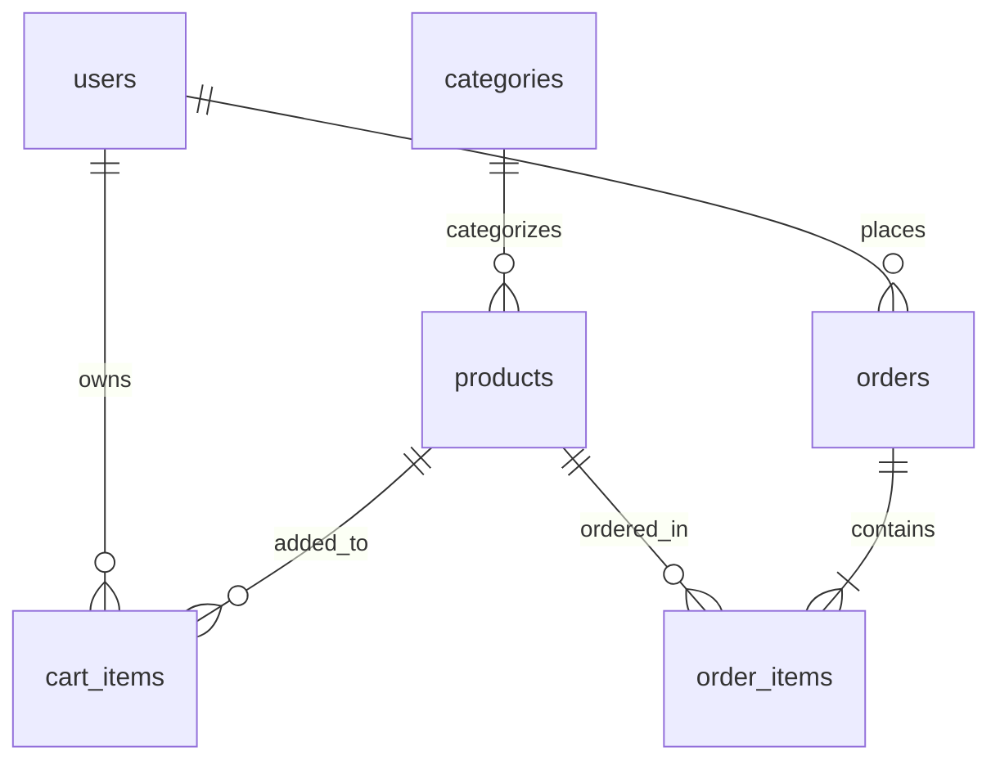

# ShopEasy — E-Commerce Application

A full-stack, responsive, and secure e-commerce platform built with **Node.js, Express.js, SQLite (better-sqlite3), and Vanilla JavaScript**. Designed to demonstrate end-to-end client-server architecture, database transactions, role-based access control, and Cash on Delivery order processing.

---

## 1. Project Overview & Objectives

**ShopEasy** is a complete, beginner-to-advanced internship-grade web application where:
- **Guests** can seamlessly browse, search by keyword, filter by categories, sort by price/name, view product details, and check stock availability.
- **Customers** can register, log in, maintain a persistent shopping cart with live inventory verification, place Cash on Delivery (COD) orders protected by database transactions, track past orders, and cancel placed orders.
- **Administrators** have access to a secure, role-protected portal displaying real-time aggregated store analytics, complete product catalog CRUD with low-stock alerts, and full order lifecycle management (`Placed` &rarr; `Shipped` &rarr; `Delivered`).

### Key Highlights
- **Atomic Database Transactions:** Multi-step checkout (order creation, order items persistence, stock deduction, and cart clearing) executes inside an atomic SQLite transaction, ensuring zero overselling and rollback on failure.
- **Financial Precision:** Product prices and order totals are stored strictly as integer **paise** (1 Rupee = 100 paise), avoiding IEEE 754 floating-point currency calculation errors.
- **Security First:** Passwords hashed with `bcryptjs` (10 rounds), stateless JWT authentication, server-side validation on all user inputs, parameterized SQL statements, and strict role authorization.
- **Modern Responsive Design:** Crafted with modern CSS Grid and Flexbox, custom design tokens, responsive typography, micro-interactions, and support down to 360px mobile screens.

---

## 2. Technology Stack

- **Backend:** Node.js (v18+), Express.js (REST APIs returning structured JSON).
- **Database:** SQLite with `better-sqlite3` (WAL mode enabled, strict foreign key enforcement via `PRAGMA foreign_keys = ON;`).
- **Security:** `bcryptjs` (password hashing), `jsonwebtoken` (JWT authentication), `dotenv` (environment variables).
- **Frontend:** HTML5, Modern CSS3 (Vanilla CSS with design system, glassmorphism, responsive grid), Vanilla JavaScript (ES6+), Fetch API.
- **Testing:** Jest, Supertest for automated integration and regression testing.

---

## 3. Project Folder Structure

```
shopeasy/
├── server/
│   ├── app.js               # Express application initialization and middleware
│   ├── db.js                # SQLite connection, foreign keys, and helpers
│   ├── schema.sql           # DDL: Tables, constraints, and indexes
│   ├── seed.sql             # SQL seed records (categories, products, accounts)
│   ├── seed.js              # Command-line seed runner script
│   ├── middleware/
│   │   ├── auth.js          # JWT verification & req.user attachment
│   │   ├── adminOnly.js     # Role-based 403 authorization guard
│   │   └── validate.js      # Input validators (email, phone, pincode, integers)
│   └── routes/
│       ├── auth.js          # /api/auth (register, login, me)
│       ├── products.js      # /api/products (public browse + admin CRUD)
│       ├── categories.js    # /api/categories (list + admin CRUD)
│       ├── cart.js          # /api/cart (customer cart operations)
│       ├── orders.js        # /api/orders (transactional COD checkout)
│       └── admin.js         # /api/admin (stats, orders management)
├── public/
│   ├── css/
│   │   └── styles.css       # Unified design system & responsive styling
│   ├── js/
│   │   ├── api.js           # API fetch client, formatRupees, toast system
│   │   ├── auth.js          # Client auth state, dynamic navbar, route guards
│   │   ├── products.js      # Catalog search, filter, pagination, details
│   │   ├── cart.js          # Shopping cart UI, quantity adjustments
│   │   ├── checkout.js      # COD form validation & checkout submission
│   │   ├── orders.js        # Order history listing & order details modal
│   │   └── admin.js         # Admin dashboard stats, products CRUD, orders
│   ├── index.html           # Public storefront / product catalog
│   ├── product.html         # Product detail view
│   ├── login.html           # Login page with demo credentials quick-fill
│   ├── register.html        # Customer registration page
│   ├── cart.html            # Customer shopping cart
│   ├── checkout.html        # Cash on Delivery checkout page
│   ├── success.html         # Order confirmation page
│   ├── orders.html          # Customer order history
│   └── admin/
│       ├── dashboard.html   # Admin metrics dashboard
│       ├── products.html    # Admin product inventory table & forms
│       └── orders.html      # Admin order status management
├── tests/
│   ├── auth.test.js         # Authentication & RBAC test suite
│   ├── products.test.js     # Catalog, pagination & admin CRUD test suite
│   ├── cart.test.js         # Cart operations & ownership test suite
│   └── orders.test.js       # Transactional checkout & cancellation test suite
├── docs/
│   ├── er-diagram.md        # Mermaid ER diagram and relational documentation
│   └── api-docs.md          # REST API endpoints reference
├── .env.example             # Environment configuration template
├── .gitignore               # Ignored dependencies, DB files, and secrets
├── package.json             # NPM package specification & test scripts
└── README.md                # Project documentation
```

---

## 4. Prerequisites

- **Node.js:** v18.0.0 or later (Tested on Node v24.19.0).
- **npm:** v9.0.0 or later.
- Modern web browser (Chrome, Edge, Firefox, Safari).

---

## 5. Installation & Setup Instructions

### Step 1: Clone or Navigate to the Project Directory
```bash
cd "c:\Users\lenovo\OneDrive\Desktop\Intern project1"
```

### Step 2: Install Dependencies
```bash
npm install
```

### Step 3: Configure Environment Variables
Copy `.env.example` to create your local `.env`:
```bash
# On Windows PowerShell:
Copy-Item .env.example .env

# On Linux / macOS / Bash:
cp .env.example .env
```

Your `.env` file will look like:
```env
PORT=3000
JWT_SECRET=shopeasy_jwt_secure_secret_token_key_2026_xyz987
JWT_EXPIRES_IN=1d
DATABASE_PATH=./server/shopeasy.db
NODE_ENV=development
```

> **Generating a Secure JWT Secret:**
> To generate a cryptographically strong secret, run:
> ```bash
> node -e "console.log(require('crypto').randomBytes(32).toString('hex'))"
> ```

### Step 4: Initialize and Seed the SQLite Database
Run the automated seed runner:
```bash
npm run seed
```
This script creates tables with constraints and indexes (if not already existing) and seeds initial categories, products, and default accounts.

---

## 6. How to Run the Application

### Start Development Server:
```bash
npm start
```
Or with auto-restart on file changes:
```bash
npm run dev
```

### Application URL:
Open your browser and navigate to:
```
http://localhost:3000
```

---

## 7. Default Credentials for Testing

| Role | Email | Password | Access Privileges |
| :--- | :--- | :--- | :--- |
| **Administrator** | `admin@shopeasy.com` | `Admin@123` | Full Admin Dashboard, Catalog CRUD, Order Management |
| **Customer** | `customer@shopeasy.com` | `Customer@123` | Browsing, Persistent Cart, COD Checkout, My Orders |

*(Note: On `login.html`, click the quick-fill chips under the login form to automatically populate either account for fast testing.)*

---

## 8. Database Architecture & Schema

All prices are stored as integer **paise** (`₹499.00` = `49900` paise). Foreign keys are enabled on every connection (`PRAGMA foreign_keys = ON;`).



### Schema Summary:
1. **`users`**: `id`, `name`, `email` (UNIQUE), `password_hash`, `role` (customer | admin), `phone`, `address`, `created_at`.
2. **`categories`**: `id`, `name` (UNIQUE).
3. **`products`**: `id`, `category_id` (FK), `name`, `description`, `price` (in paise), `stock`, `image_url`, `is_active`, `created_at`.
4. **`cart_items`**: `id`, `user_id` (FK), `product_id` (FK), `quantity`, `UNIQUE(user_id, product_id)`.
5. **`orders`**: `id`, `user_id` (FK), `total_amount` (in paise), `status` (Placed | Shipped | Delivered | Cancelled), `shipping_name`, `shipping_phone`, `shipping_address`, `shipping_city`, `shipping_pincode`, `payment_method`, `created_at`.
6. **`order_items`**: `id`, `order_id` (FK), `product_id` (FK), `quantity`, `unit_price` (in paise, captured at purchase time).

Detailed entity documentation: see [docs/er-diagram.md](file:///c:/Users/lenovo/OneDrive/Desktop/Intern%20project1/docs/er-diagram.md).

---

## 9. API Reference Overview

Detailed REST API specifications are documented in [docs/api-docs.md](file:///c:/Users/lenovo/OneDrive/Desktop/Intern%20project1/docs/api-docs.md).

| Method | Endpoint | Access | Description |
| :--- | :--- | :--- | :--- |
| **POST** | `/api/auth/register` | Public | Register new customer |
| **POST** | `/api/auth/login` | Public | Login and receive JWT token |
| **GET** | `/api/auth/me` | Authenticated | Retrieve authenticated user profile |
| **GET** | `/api/products` | Public | Search, filter by category, sort, and paginate products |
| **GET** | `/api/products/:id` | Public | View individual product details |
| **POST** | `/api/products` | Admin | Create new product |
| **PUT** | `/api/products/:id` | Admin | Update existing product |
| **DELETE**| `/api/products/:id` | Admin | Delete or safely deactivate product |
| **GET** | `/api/categories` | Public | List categories with product counts |
| **POST** | `/api/categories` | Admin | Create category |
| **GET** | `/api/cart` | Customer | Fetch cart items with recalculated totals |
| **POST** | `/api/cart` | Customer | Add product to cart with stock validation |
| **PUT** | `/api/cart/:itemId` | Customer | Update cart item quantity |
| **DELETE**| `/api/cart/:itemId` | Customer | Remove cart item |
| **POST** | `/api/orders` | Customer | Place Cash on Delivery order via DB transaction |
| **GET** | `/api/orders` | Customer | Retrieve current customer's order history |
| **GET** | `/api/orders/:id` | Customer / Admin | Retrieve order details (with ownership enforcement) |
| **PATCH**| `/api/orders/:id/cancel` | Customer / Admin | Cancel 'Placed' order & restore inventory stock |
| **GET** | `/api/admin/stats` | Admin | Aggregated database business metrics |
| **GET** | `/api/admin/orders` | Admin | All orders with customer info & filters |
| **PATCH**| `/api/admin/orders/:id/status` | Admin | Update order status (`Placed` &rarr; `Shipped` &rarr; `Delivered`) |

---

## 10. Automated Testing Instructions

Automated end-to-end integration tests are implemented using **Jest** and **Supertest**.

To execute the test suite:
```bash
npm test
```

### Verified Test Coverage:
- **Authentication:** Registration, unique email rejection (409), short password rejection (400), login validation, JWT verification, customer 403 access control on admin routes, prevention of role escalation.
- **Products & Categories:** Paginated listing (8/page), search query matching, category filtering, price sorting, 404 for missing products, admin-only CRUD, safe category deletion.
- **Cart:** Authenticated addition, line total calculation, duplicate row prevention, quantity increment/decrement, rejection when quantity exceeds stock, ownership isolation across users.
- **Orders & Checkout:** Rejection of empty carts, validation of Indian phone & postal PIN codes, atomic transaction execution, stock deduction, cart clearing, purchase-time unit price preservation, status lifecycle flow, cancellation stock restoration.

---

## 11. Security & Storage Strategy

- **JWT Strategy:** Stored in `localStorage` for client state persistence. The application enforces server-side authentication on every private endpoint and uses contextual HTML escaping (`escapeHtml()`) across all DOM manipulation to eliminate Cross-Site Scripting (XSS) risks.
- **Database Safety:** 100% of SQL statements utilize parameterized queries (`better-sqlite3`), completely preventing SQL injection attacks.
- **Error Obfuscation:** Centralized error handling prevents exposure of stack traces, raw SQL queries, or internal system paths to clients.

---

## 12. License
This project is open-source and created for learning, internship, and educational demonstration purposes.
