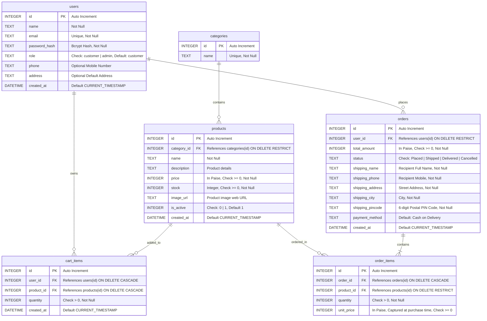

# ShopEasy — Entity-Relationship (ER) Diagram & Schema Specification

This document details the relational database design for **ShopEasy**, implemented using SQLite with foreign key enforcement (`PRAGMA foreign_keys = ON;`) and WAL journaling mode.

## 1. Entity-Relationship Diagram (Mermaid)

---

## 2. Table Specifications & Constraints

### `users`
- **Primary Key:** `id`
- **Email Uniqueness:** Case-insensitive lookup and `UNIQUE` constraint prevent multiple accounts with the same email.
- **Role Enforcement:** Constrained by `CHECK(role IN ('customer', 'admin'))`. Default is always `'customer'`. Public registration routes never accept client-supplied role values.
- **Passwords:** Never stored in plain text; hashed using `bcrypt` (10 rounds).

### `categories`
- **Primary Key:** `id`
- **Name:** `UNIQUE NOT NULL`.
- **Integrity:** Safe deletion check: Deletion is rejected if products are currently assigned to the category.

### `products`
- **Primary Key:** `id`
- **Category Reference:** `category_id` references `categories(id)` with `ON DELETE RESTRICT`.
- **Currency Storage:** `price` is strictly stored as an integer representing currency in **paise** (1 Rupee = 100 paise) to eliminate IEEE 754 floating-point rounding errors.
- **Stock Integrity:** `CHECK(stock >= 0)`.
- **Soft Deletion / Deactivation:** When a product has historical orders (`order_items`), attempts to delete it automatically trigger deactivation (`is_active = 0`) instead of hard deletion to preserve historical order logs.

### `cart_items`
- **Primary Key:** `id`
- **Uniqueness Constraint:** `UNIQUE(user_id, product_id)` prevents redundant rows for the same product in a customer's cart.
- **Cascading Deletion:** If a user account or a product is deleted, associated cart rows cascade delete.

### `orders`
- **Primary Key:** `id`
- **User Reference:** `user_id` references `users(id)` with `ON DELETE RESTRICT`.
- **Status Lifecycle:** `CHECK(status IN ('Placed', 'Shipped', 'Delivered', 'Cancelled'))`. Default is `'Placed'`.
- **Payment Method:** Default is `'Cash on Delivery'`.
- **Total Amount:** Stored in paise; validated and calculated on the backend from active product prices.

### `order_items`
- **Primary Key:** `id`
- **Historical Price Capture:** `unit_price` captures the exact price in paise at the time of purchase. Future changes to product catalog prices do not alter historical orders.
- **Quantity:** `CHECK(quantity > 0)`.

---

## 3. Database Indexes

- `idx_products_category`: Optimizes category filter queries (`WHERE category_id = ?`).
- `idx_products_active`: Optimizes catalog queries filtering active items (`WHERE is_active = 1`).
- `idx_cart_user`: Accelerates user cart lookups (`WHERE user_id = ?`).
- `idx_orders_user`: Accelerates customer order history lookups (`WHERE user_id = ?`).
- `idx_orders_status`: Accelerates administrative status filtering (`WHERE status = ?`).
- `idx_order_items_order`: Accelerates order details joining (`WHERE order_id = ?`).
